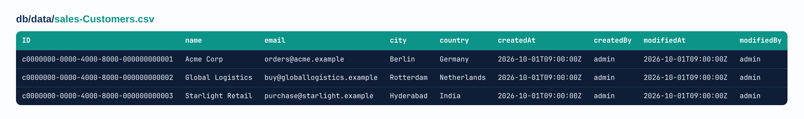
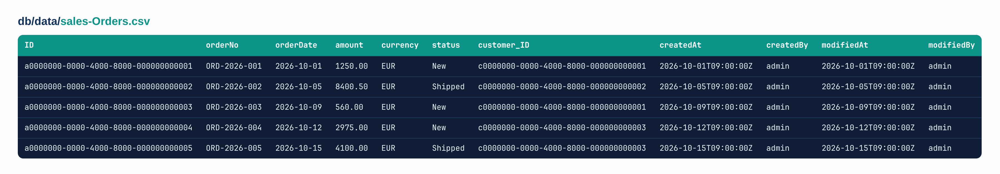

# Build Your First SAP CAP App from Zero

Most people think building an SAP app needs months of coding. It doesn't.

In this guide, we build a small Sales Orders app from an empty folder. Customers, orders, a working API, sample data, and a real Fiori screen. And we write no JavaScript at all.

You can follow it with no SAP or coding background. Every new word gets a one-line explanation.

Prefer to watch? The full video walkthrough is here: [clickERP on YouTube](https://www.youtube.com/@clickERP)

## The use case

A small company sells to business customers. They ask us for one app to manage their customers and their orders. Here is what they need:

1. Store customers and orders.
2. Open a customer and see all their orders.
3. Know who created or changed a record, and when.
4. Every order belongs to one customer.

We build that app in this guide.

## What you will build

- A **data model** with two entities: Customers and Orders.
- An **OData API** that can read, create, change and delete them.
- **Sample data** loaded from CSV files.
- A **Fiori app** with a customer list and a detail page.

## How the app is built

A CAP app has three layers, and each one has its own folder.

- **Data model (`db/`):** what we store. We describe Customers and Orders in CDS. CAP turns them into database tables.
- **Database:** where the data lives. While we develop, CAP uses **SQLite**, a small database that runs in memory. In production, the same model runs on **SAP HANA Cloud**. We don't change our code for that.
- **Service (`srv/`):** what we show. The service turns our entities into an **OData API**, a set of web addresses that other programs can call.
- **Frontend (`app/`):** how it looks. **Fiori Elements** draws ready-made SAP screens from the service, guided by **annotations**.

The data model has two entities, and one customer can have many orders.

## Before you start

You need two free things.

- **An SAP BTP trial account.** SAP BTP is SAP's cloud platform.
- **SAP Business Application Studio (BAS).** BAS is a code editor that runs in your browser, with all CAP tools already installed.

In BAS, create a **dev space** of type *Full Stack Cloud Application*. A dev space is your own workspace. Start it and open it.

One more word first. **CAP** is SAP's framework for business apps. You describe the data, and CAP builds the rest.

## Step 1: Create the project

Open a terminal in BAS. First, create the project:

```bash
cds init cap-first-app-sales-orders --nodejs
```

Then go into the new project folder:

```bash
cd cap-first-app-sales-orders
```

Then start the app:

```bash
cds watch
```

CAP creates three folders, and each one has one job:

- `db` is what we store: the data.
- `srv` is what we show: the service.
- `app` is how it looks: the screens.

`cds watch` starts the app and restarts it every time you save a file. Right now it says "no models found". That's fine, the project is still empty. Keep it running.

## Step 2: Describe the data

In the `db` folder, create a file called `schema.cds`. **CDS** is the simple language CAP uses to describe data.

```cds
namespace sales;

using { cuid, managed } from '@sap/cds/common';

// A company that buys from us
entity Customers : cuid, managed {
  name    : String(100) @mandatory;
  email   : String(100);
  city    : String(50);
  country : String(50);
  orders  : Association to many Orders on orders.customer = $self;  // all orders of this customer
}

// One order placed by a customer
entity Orders : cuid, managed {
  orderNo   : String(20) @mandatory;
  orderDate : Date;
  amount    : Decimal(10,2);
  currency  : String(3) default 'EUR';
  status    : String(20) default 'New';
  customer  : Association to Customers;  // the customer who placed the order
}
```

Here's what each part means.

- **Namespace** `sales` is a prefix for all names. So `Customers` is really `sales.Customers`.
- An **entity** is one kind of business object. It becomes a table in the database.
- An **aspect** is a ready-made set of fields you add with one word. `cuid` adds a unique key called `ID`. `managed` adds createdAt, createdBy, modifiedAt and modifiedBy. CAP fills all of them for you.
- `@mandatory` means the field can't be empty. A customer without a name is refused.
- `default` is the value CAP uses when nobody sends one.
- An **association** is a link from one entity to another. `customer : Association to Customers` links each order to its customer. Behind the scenes, CAP adds a field called `customer_ID`. Remember that name.
- `Association to many Orders on orders.customer = $self` is the other direction. `$self` means "this customer". It adds no column. CAP finds the orders with the condition.

Save. `cds watch` restarts and loads your model.

## Step 3: Expose the data with a service

The data exists, but nobody can reach it yet. A **service** is the API of your app. It decides which entities the outside world can use.

In the `srv` folder, create `customer-service.cds`:

```cds
using sales from '../db/schema';

service CustomerService {
  entity Customers as projection on sales.Customers;
  entity Orders    as projection on sales.Orders;
}
```

A **projection** shows an entity through the service. It could also hide fields, but today we show everything.

Save, and you have a full API. CAP serves it at `/odata/v4/customer`: the service name without "Service", in lower case. **OData** is the standard web protocol CAP uses for its API.

## Step 4: Add sample data with cds add data

Open a second terminal and type:

```bash
cds add data
```

CAP creates a `db/data` folder with two **CSV files**. A CSV file is a text file with rows of data. Look at the names: `sales-Customers.csv` and `sales-Orders.csv`. It's always namespace, dash, entity name. If the name is wrong, CAP doesn't load the data.

Each file has only the header line. Notice the four extra columns at the end: createdAt, createdBy, modifiedAt and modifiedBy. They come from the `managed` aspect. We fill them too, so the sample data looks like real records. Now add the rows. Copy this into `db/data/sales-Customers.csv`, replacing what's there:



*The image shows the first rows. Copy the full file from the box below.*

```csv
ID,name,email,city,country,createdAt,createdBy,modifiedAt,modifiedBy
c0000000-0000-4000-8000-000000000001,Acme Corp,orders@acme.example,Berlin,Germany,2026-10-01T09:00:00Z,admin,2026-10-01T09:00:00Z,admin
c0000000-0000-4000-8000-000000000002,Global Logistics,buy@globallogistics.example,Rotterdam,Netherlands,2026-10-01T09:00:00Z,admin,2026-10-01T09:00:00Z,admin
c0000000-0000-4000-8000-000000000003,Starlight Retail,purchase@starlight.example,Hyderabad,India,2026-10-01T09:00:00Z,admin,2026-10-01T09:00:00Z,admin
c0000000-0000-4000-8000-000000000004,Nordic Foods,info@nordicfoods.example,Oslo,Norway,2026-10-15T09:00:00Z,admin,2026-10-15T09:00:00Z,admin
c0000000-0000-4000-8000-000000000005,Sunrise Pharma,procurement@sunrisepharma.example,Mumbai,India,2026-10-15T09:00:00Z,admin,2026-10-15T09:00:00Z,admin
```

And this into `db/data/sales-Orders.csv`:



*The image shows the first rows. Copy the full file from the box below.*

```csv
ID,orderNo,orderDate,amount,currency,status,customer_ID,createdAt,createdBy,modifiedAt,modifiedBy
a0000000-0000-4000-8000-000000000001,ORD-2026-001,2026-10-01,1250.00,EUR,New,c0000000-0000-4000-8000-000000000001,2026-10-01T09:00:00Z,admin,2026-10-01T09:00:00Z,admin
a0000000-0000-4000-8000-000000000002,ORD-2026-002,2026-10-05,8400.50,EUR,Shipped,c0000000-0000-4000-8000-000000000002,2026-10-05T09:00:00Z,admin,2026-10-05T09:00:00Z,admin
a0000000-0000-4000-8000-000000000003,ORD-2026-003,2026-10-09,560.00,EUR,New,c0000000-0000-4000-8000-000000000001,2026-10-09T09:00:00Z,admin,2026-10-09T09:00:00Z,admin
a0000000-0000-4000-8000-000000000004,ORD-2026-004,2026-10-12,2975.00,EUR,New,c0000000-0000-4000-8000-000000000003,2026-10-12T09:00:00Z,admin,2026-10-12T09:00:00Z,admin
a0000000-0000-4000-8000-000000000005,ORD-2026-005,2026-10-15,4100.00,EUR,Shipped,c0000000-0000-4000-8000-000000000003,2026-10-15T09:00:00Z,admin,2026-10-15T09:00:00Z,admin
a0000000-0000-4000-8000-000000000006,ORD-2026-006,2026-10-18,1890.00,EUR,New,c0000000-0000-4000-8000-000000000004,2026-10-18T09:00:00Z,admin,2026-10-18T09:00:00Z,admin
a0000000-0000-4000-8000-000000000007,ORD-2026-007,2026-10-20,6320.00,EUR,Shipped,c0000000-0000-4000-8000-000000000002,2026-10-20T09:00:00Z,admin,2026-10-20T09:00:00Z,admin
a0000000-0000-4000-8000-000000000008,ORD-2026-008,2026-10-22,745.50,EUR,New,c0000000-0000-4000-8000-000000000005,2026-10-22T09:00:00Z,admin,2026-10-22T09:00:00Z,admin
a0000000-0000-4000-8000-000000000009,ORD-2026-009,2026-10-24,3260.00,EUR,Shipped,c0000000-0000-4000-8000-000000000005,2026-10-24T09:00:00Z,admin,2026-10-24T09:00:00Z,admin
a0000000-0000-4000-8000-000000000010,ORD-2026-010,2026-10-26,980.00,EUR,New,c0000000-0000-4000-8000-000000000004,2026-10-26T09:00:00Z,admin,2026-10-26T09:00:00Z,admin
```

Look at the last column of the orders file. Each `customer_ID` is the `ID` of a customer from the first file. That's how each order is linked to its customer. That gives us five customers and ten orders, and every customer has two orders.

Save both files. `cds watch` loads them into **SQLite**, a small database that runs in memory. Every restart gives you fresh sample data.

## Step 5: Read the data in the browser

BAS shows a link for port 4004. Open it, and you see the CAP welcome page. Add these paths after the address:

```text
/odata/v4/customer/Customers
/odata/v4/customer/Orders
/odata/v4/customer/$metadata
/odata/v4/customer/Customers(c0000000-0000-4000-8000-000000000001)
/odata/v4/customer/Customers(c0000000-0000-4000-8000-000000000001)?$expand=orders
/odata/v4/customer/Orders?$expand=customer($select=name)
/odata/v4/customer/Orders?$filter=status eq 'New'&$orderby=amount desc
```

The ID `c0000000-0000-4000-8000-000000000001` is Acme Corp from our sample data.

- `$metadata` describes your service. Fiori reads it to know your data.
- `Customers(<ID>)` reads one customer by its key.
- `$expand` follows an association, so you get Acme Corp with both of its orders.
- `$filter` picks rows, and `$orderby` sorts them.

Notice the createdAt, createdBy, modifiedAt and modifiedBy fields. They come from the `managed` aspect. For the sample data we filled them in the CSV. When you create a new record in Step 6, CAP fills them for you.

## Step 6: Create data with test.http

A browser can only read. To create data, we need a POST request. Create a file called `test.http` in the project folder:

```http
@server = http://localhost:4004
@service = {{server}}/odata/v4/customer

### 1. Read all customers
GET {{service}}/Customers

### 2. Create a new order for Global Logistics
POST {{service}}/Orders
Content-Type: application/json

{
  "orderNo": "ORD-2026-100",
  "orderDate": "2026-10-26",
  "amount": 3200.00,
  "customer_ID": "c0000000-0000-4000-8000-000000000002"
}

### 3. Create a customer without a name: refused with 400 (@mandatory)
POST {{service}}/Customers
Content-Type: application/json

{ "city": "Paris" }
```

Click **Send Request** above each one.

- Request 1 returns 200 OK with your customers.
- Request 2 returns 201 Created. CAP filled in the ID, the status New and the created fields.
- Request 3 returns 400 Bad Request. That's `@mandatory` at work.

## Step 7: Generate the Fiori app

**Fiori Elements** is SAP's set of ready-made screens. It draws them from annotations instead of UI code. An **annotation** is a note in CDS that tells Fiori how to show the data.

Open the command palette and choose *Fiori: Open Application Generator*. Answer like this:

| Question | Answer |
| --- | --- |
| Template | List Report Page |
| Data source | Use a Local CAP Project |
| CAP project | cap-first-app-sales-orders |
| OData service | CustomerService (Node.js) |
| Main entity | Customers |
| Navigation entity | orders |
| Module name | sales-orders |

A **List Report** is the list screen. From each row you open an **Object Page** with the details.

The generator creates `app/sales-orders` with `manifest.json` and `annotations.cds`. `UI.LineItem` in that file sets the list columns. Run `npm install` if BAS asks, then open the app from the welcome page.

## Step 8: Show the customer name as the page title

Open a customer, and the header shows a long ID. That's because we never told Fiori which field is the title, so it shows the key.

In `app/sales-orders/annotations.cds`, inside `annotate service.Customers with @( ... )`, add this block at the top:

```cds
    UI.HeaderInfo : {
        Title          : { Value : name },
    },
```

Save and refresh. The header now shows "Acme Corp" instead of the ID.

## Common mistakes

- CSV named `Customers.csv` instead of `sales-Customers.csv`: no data loads.
- `customer_ID` values that don't match a customer: `$expand=customer` returns nothing.
- Wrong path in `using ... from`: you get "model not found".
- POST with `customer` instead of `customer_ID`: the order has no customer.
- POST without `Content-Type: application/json`: you get a 415 error.
- Fiori list with no columns: `UI.LineItem` is missing.

## Your challenge

Add a title to the order page, so it shows the order number instead of the ID. Try it, then share how it went in the video's comments.

## What's next

With about 40 lines of CDS, you built a database, an OData API, sample data and a Fiori app.

Watch me build it step by step on YouTube: [clickERP on YouTube](https://www.youtube.com/@clickERP)

Next guide: Customer Notes, connecting CAP to SAP S/4HANA data.
